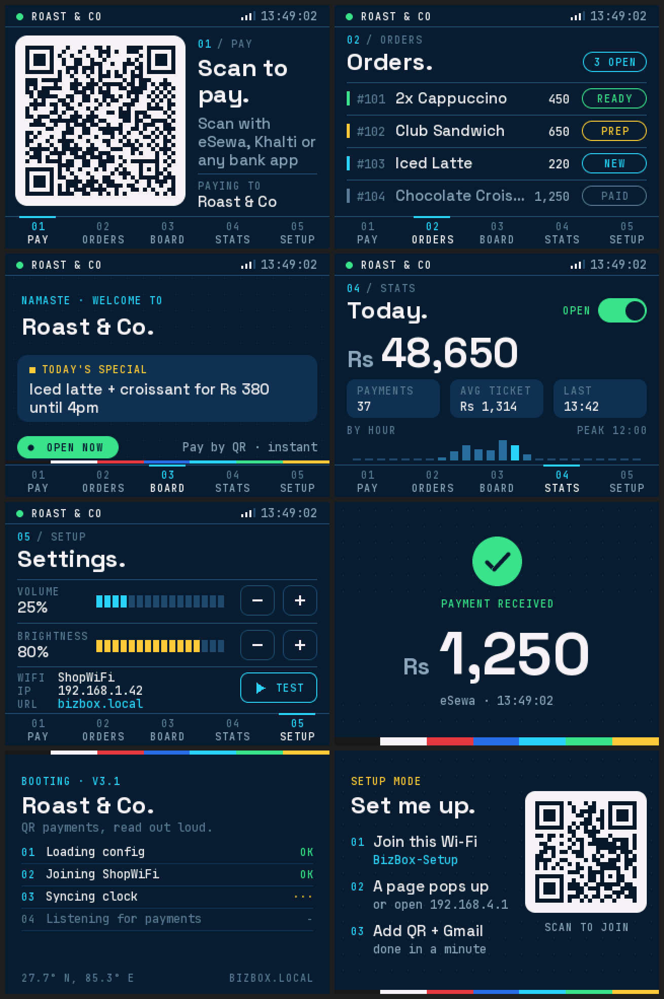
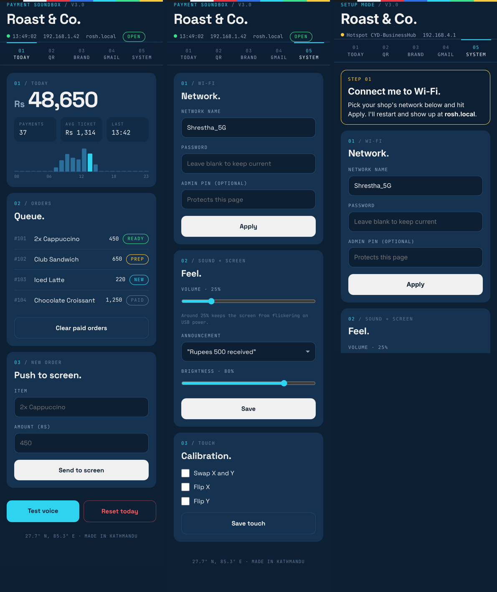

# BizBox-CYD

An open-source business hub for a shop counter, built on the ESP32 "Cheap Yellow Display" (ESP32-2432S028, 2.8" 320×240 touchscreen). It shows your payment QR, watches for payment emails, and reads each payment out loud ("rupees five hundred received"). It also runs a small orders board, a customer-facing promo board, today's stats, and a phone dashboard at `http://bizbox.local`. Through **Connect** it plugs into your own management system.



## What it does

- **Pay:** your eSewa / Fonepay / Khalti merchant QR, big and scannable.
- **Payment alerts:** reads Gmail over IMAP (or a Google Apps Script webhook, or a local API call), then shows a full-screen "payment received" and speaks the amount, paisa included. Only emails whose subject reads like a payment ("Rs 1,500.00 received") are announced and marked read; the rest of the inbox is left alone.
- **Orders:** a kitchen-style queue (NEW → PREP → READY → PAID). Tap to advance; the list survives reboots.
- **Board:** welcome screen and today's special for customers, auto-flips with the QR.
- **Stats:** today's total, payment count, average ticket, sales by hour; resets at midnight Nepal time.
- **Setup:** volume, brightness, Wi-Fi info, voice test.
- **Phone dashboard:** everything above, plus QR, brand, Gmail, Connect and Wi-Fi settings. First boot opens a setup hotspot (`BizBox-Setup`) with a scan-to-join QR. If the saved Wi-Fi is down at boot, the device keeps retrying it and leaves setup mode by itself.
- **Connect:** webhooks out (payment received, order created, order status changed) and polling in (orders and commands from your system), so any management system can plug in even though the box sits behind NAT. See [docs/CONNECT.md](docs/CONNECT.md).



## Build

Arduino IDE (or arduino-cli) with:

| Library | Version | Notes |
|---|---|---|
| ESP32 Arduino core | 2.0.x or 3.x | both supported, see the partition note below |
| TFT_eSPI | 2.5+ | `User_Setup.h` must have your CYD pins, `USE_HSPI_PORT` and `SMOOTH_FONT`; [`ci/User_Setup.h`](ci/User_Setup.h) is a ready one |
| ArduinoJson | 7.x | |
| ESP8266Audio | 1.9.9 on core 2.x, 2.x on core 3.x | only its `AudioOutput` base class is used; 2.x needs core 3 |
| ESP8266SAM | 1.1.0 | speech synth; not in the Library Manager, install the ZIP from [GitHub](https://github.com/earlephilhower/ESP8266SAM) |

QR encoding is built in (`qr_encode.h/.c`, from ricmoo/QRCode). The separate QRCode library is no longer needed: on core 3.x its header clashes with ESP-IDF's own `qrcode.h`.

- **Board:** "ESP32 Dev Module".
- **Partition scheme:** the sketch fits the default scheme on core 2.x. On core 3.x it needs **Partition Scheme → Huge APP** (the core itself is bigger). CI reports exact sizes on every push.
- The sketch folder must be named `esp/` (Arduino wants `esp/esp.ino`).

> Updating TFT_eSPI through the Library Manager overwrites `User_Setup.h`. Back it up first.

Every push is compiled for core 2.0.17 and the latest 3.x by [GitHub Actions](.github/workflows/build.yml). The job summary shows flash and RAM use, and the `.bin` files are attached to the run.

## First run and security

1. Join the `BizBox-Setup` hotspot, pick your Wi-Fi in the page that pops up, then reboot.
2. Open `http://bizbox.local`, set your QR, Gmail (address plus a 16-character [App Password](https://myaccount.google.com/apppasswords)) and an **admin PIN** (System tab).
3. Without a PIN, anyone on your Wi-Fi can open the dashboard. Passwords are never shown back in the page, and 5 wrong PINs lock it for a minute.
4. The REST API needs the **API token** from the System tab (`Authorization: Bearer <token>`). *Make a new token* revokes the old one.

Hold the BOOT button for 3.5 s to wipe all settings.

## Files

| File | What's in it |
|---|---|
| `esp.ino` | library includes, global objects, `setup()` and `loop()` |
| `hw.h` | pins, XPT2046 touch driver, backlight PWM |
| `model.h` | shared state: config, orders, today's numbers |
| `ui.h` | the whole screen UI: palette, fonts (cached), components, every screen, partial redraws |
| `speaker.h` | voice output straight to the DAC on GPIO26 |
| `textutil.h` | pure helpers: amount parsing, MIME decoding, numbers to words, escaping (unit-tested) |
| `imap.h` | Gmail reader (IMAP with deadlines, UID tracking) |
| `net.h`, `nettask.h` | the network task (core 0): payment polling, Connect webhooks and pull |
| `connect.h`, `presets.h` | Connect layer and its presets ([docs/CONNECT.md](docs/CONNECT.md)) |
| `storage.h` | everything in NVS |
| `app.h` | orders, sales, announcements, screen changes |
| `input.h` | touch and the BOOT button |
| `wifi.h` | joining Wi-Fi, setup hotspot |
| `web.h` | the phone dashboard (HTML/CSS/JS, streamed) and REST API |
| `fonts.h` | generated anti-aliased fonts (Space Grotesk + JetBrains Mono) |
| `qr_encode.h/.c` | QR encoder (vendored ricmoo/QRCode, MIT) |
| `docs/` | [code review](docs/REVIEW.md), [Connect](docs/CONNECT.md) |
| `ci/` | TFT_eSPI setup for the CYD, used by CI |
| `previews/` | rendered screenshots of every screen and the dashboard |
| `tools/` | font generator, screen simulator, desktop compile check and tests |

## Local API

Every `/api/*` call needs `Authorization: Bearer <API token>` (System tab). Amounts are rupees and may have paisa (`499.5` or `"1,200.50"`).

| Method | Path | Body | Does |
|---|---|---|---|
| GET | `/api/state` | | today's numbers, orders, status (including Connect) as JSON |
| POST | `/api/payment` | `{"amount":500,"note":"eSewa"}` | logs and announces a payment (answers immediately) |
| POST | `/api/order` | `{"title":"2x Latte","amount":450,"status":"NEW"}` | adds an order to the screen |
| POST | `/api/test` | `{"amount":100}` (optional) | plays a TEST announcement (not booked) |
| POST | `/api/clear` | | removes paid orders |
| POST | `/api/reset` | | zeroes today's numbers |
| POST | `/api/connect/test` | | queues a test webhook |
| POST | `/api/connect/pull` | | pulls from the Connect URL now |

```bash
curl -H "Authorization: Bearer $TOKEN" -H "Content-Type: application/json" \
     -d '{"amount":500,"note":"Cash"}' http://bizbox.local/api/payment
```

Errors come back as `{"error":"..."}` with status 400 (bad input) or 401 (missing or wrong token).

## Tools

```bash
export ARDUINOJSON_SRC=~/Arduino/libraries/ArduinoJson/src   # if not found automatically
tools/check.sh          # compile the sketch against stand-ins (core 2.x and 3.x) + all unit tests
tools/preview.sh        # re-render previews/ from the real UI code (and check partial redraws)
tools/preview.sh --web  # also the dashboard (needs Playwright; CHROMIUM=/path/to/chrome to reuse a browser)
python3 tools/fonts/gen_fonts.py   # regenerate fonts.h after changing sizes/weights
```

Font sources and their licenses are in `tools/fonts/`.

## License

MIT, see [LICENSE](LICENSE). The bundled fonts (Space Grotesk, JetBrains Mono) are under the SIL Open Font License 1.1. `qr_encode.h/.c` are from [ricmoo/QRCode](https://github.com/ricmoo/QRCode) (MIT).
